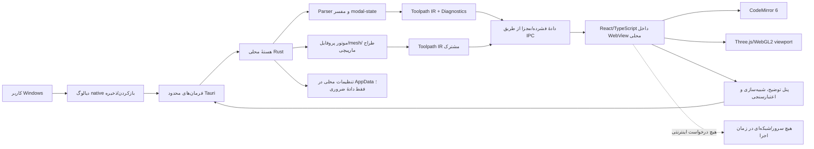

# 🏗️ مشخصات فنی و طراحی — معماری برنامهٔ دسکتاپ Windows

## 1. تصمیم فنی پیش‌فرض

برای مخزن خالی، انتخاب اصلی این پروژه:

> **Tauri 2 + Rust core + React/TypeScript/Vite UI + Three.js/WebGL2 + CodeMirror 6**

Tauri اینجا به معنی «وب‌سایت» نیست: خروجی باید پنجره و نصب‌کنندهٔ دسکتاپ Windows داشته باشد، UI به‌صورت asset محلی داخل برنامه بسته‌بندی شود و هستهٔ Rust فقط از طریق commandهای محدود و مشخص با frontend ارتباط داشته باشد. در محصول نهایی هیچ HTTP server، URL راه‌دور، backend ابری یا نیاز به مرورگر بیرونی وجود نداشته باشد.

**دلیل انتخاب:** Rust برای parser و محاسبات سنگینِ محلی مناسب است؛ React/TypeScript و Three.js برای ویرایشگر/viewport پیشرفته بهره‌وری خوبی دارند؛ Tauri برای بسته‌بندی برنامهٔ دسکتاپ و محدودکردن دسترسی frontend به native capabilityها مناسب است.

### نصب آفلاین و WebView2

- راهنمای رسمی فعلی Tauri را هنگام پیاده‌سازی بررسی کن: <https://v2.tauri.app/distribute/windows-installer/>.
- برای نصب روی Windows بدون اینترنت، `webviewInstallMode` را آگاهانه تنظیم کن؛ حالت `offlineInstaller` فایل نصب WebView2 را داخل نصب‌کننده قرار می‌دهد. اگر هدف، همراه‌بودن خود runtime ثابت با برنامه است، `fixedRuntime` را بررسی کن.
- `offlineInstaller` و `fixedRuntime` یک مفهوم نیستند: اولی نصب WebView2 را به‌صورت آفلاین ممکن می‌کند؛ دومی نسخهٔ ثابت runtime را کنار برنامه قرار می‌دهد. trade-off حجم نصب‌کننده، update امنیتی و نگه‌داری را در README توضیح بده و اعداد را از مستندات روز دوباره بررسی کن.
- از `downloadBootstrapper` یا هر نصب‌کننده‌ای که در کامپیوتر مقصد برای گرفتن runtime به اینترنت وصل می‌شود استفاده نکن، مگر اینکه نسخهٔ آفلاین هم جداگانه تحویل داده شود.
- تست نهایی را در Windows 10/11 x64 با اینترنت قطع‌شده انجام بده. اگر محیط فعلی Windows نیست، build/package را در CI یا Windows runner بساز؛ محدودیت و نتیجهٔ واقعی را گزارش کن.
- گزینهٔ جایگزین Electron + Chromium bundled فقط وقتی مجاز است که بسته‌بندی آفلاین Tauri قابل‌اعتماد نشود؛ در آن صورت اندازهٔ نصب‌کننده، RAM و سطح دسترسی Electron را مستند و `nodeIntegration` را خاموش و `contextIsolation` را روشن کن.
- اگر نیاز به «رابط کاملاً native ویندوزی» فراتر از پنجرهٔ دسکتاپ Tauri تشخیص دادی، .NET 10 WPF را در یک یادداشت تصمیم معماری با مزایا/هزینه‌ها مقایسه کن؛ بدون دلیل فنی مهاجرت نکن.

## 2. نمای معماری



### مرزبندی امنیتی و کدنویسی

- UI، parser، تفسیر state، هندسه، فایل‌سیستم و طراح پارامتریک را در ماژول‌های مشخص جدا نگه دار.
- Rust core مرجع معتبر parsing و تولید مسیر باشد؛ کامپوننت React نباید خودش با regex G-code را به هندسه تبدیل کند.
- IPC فقط commandهای دامنه‌ای و مشخص ارائه کند، مانند `open_gcode`, `parse_gcode`, `generate_toolpath`, `save_as`, `export_stl`, `save_project`; command اجرای arbitrary shell، eval یا اجرای G-code وجود نداشته باشد.
- در Tauri v2 فقط capability/permissionهای لازم را فعال کن. مسیرها را با native file dialog و انتخاب کاربر محدود کن؛ دسترسی عمومی به کل home، Documents یا filesystem را فعال نکن مگر الزام مستند و تأیید کاربر وجود داشته باشد.
- plugin shell، updater، remote domain access و plugin غیرضروری را اضافه نکن. اگر قابلیت native نیاز دارد، permission دقیق و محدود را تعریف کن.
- assetها (JS/CSS/font/help/icons) داخل installer بسته‌بندی شوند؛ از CDN و URL خارجی استفاده نکن. Content Security Policy حداقلی و بدون remote source تنظیم شود.
- Parser/generator را تا حد ممکن pure/deterministic بساز تا unit test مستقل از UI داشته باشد.
- parse/geometry سنگین در thread/worker هستهٔ Rust اجرا شود؛ Tauri command طولانی را روی UI thread قفل نکن. progress/cancel و chunked IPC برای نتایج حجیم فراهم کن.
- از JSON حجیم برای میلیون‌ها vertex استفاده نکن؛ payloadهای فشرده/چانک‌شده یا آرایه‌های numeric مؤثر انتخاب کن. انتقال previewها با benchmark شود.
- نتیجهٔ async قدیمی را پس از edit کنار بگذار: generation ID/revision به parse result و geometry نسبت بده.
- مدل دادهٔ پروژه version داشته باشد؛ migration و reject ایمن برای schema version ناشناخته در نظر بگیر.

## 3. ساختار فایل پیشنهادی

ساختار را با repo موجود سازگار کن؛ اگر خالی است، مرزبندی مشابه این را در نظر بگیر:

```text
src-tauri/
  src/
    main.rs
    commands/           # Tauri commands؛ فقط APIهای محدود
    core/
      gcode/             # lexer, parser, modal interpreter
      toolpath/          # canonical IR, arc tessellation, simulation
      designer/          # profile, geometry, patterns, textures, floor
      export/            # save, G-code, STL, project JSON, validation
    storage/             # settings/project metadata under AppData
  capabilities/         # least-privilege Tauri permissions
  tests/
src/
  app/                   # shell, navigation, state
  components/            # reusable UI and panels
  features/
    gcode-editor/
    spiral-designer/
    selected-line-inspector/
    exports/
  i18n/                  # Persian first, English keys ready
  styles/
  test-fixtures/
docs/
  ARCHITECTURE.md
  USER_GUIDE_FA.md
  SAFETY.md
  REFERENCE_AUDIT.md
```

این ساختار لفظی نیست؛ جداسازی هسته و UI، محدودبودن commandها و قابل‌آزمون‌بودن الزام‌اند.

## 4. مدل دادهٔ نمونه (مفهومی)

تعریف نهایی را با نیاز واقعی تطبیق بده؛ اما source mapping، uncertainty و diagnostics را حذف نکن.

```rust
struct Diagnostic {
    severity: Severity,
    code: String,
    message_fa: String,
    line_index: Option<usize>,
    uncertain: bool,
}

struct ToolpathSegment {
    id: u64,
    source_line_index: usize,
    kind: SegmentKind,       // extrusion, travel, retract, arc, unknown
    start_mm: Option<[f64; 3]>,
    end_mm: Option<[f64; 3]>,
    e_delta_mm: Option<f64>,
    feedrate_mm_min: Option<f64>,
    layer_index: Option<u32>,
    certainty: Certainty,    // known, approximate, unknown
}
```

فرانت‌اند می‌تواند typeهای TypeScript متناظر داشته باشد. از `unknown`/`approximate` به‌جای تبدیل ابهام به عدد ظاهراً دقیق استفاده کن.

## 5. طراحی رابط دسکتاپ

### زبان و جهت

- زبان پایه فارسی، `dir="rtl"` روی shell؛ بخش کد، parameterها و مقادیر فنی در container با `dir="ltr"`.
- عبارت‌های فنی در اولین حضور می‌توانند فارسی + اصطلاح انگلیسی باشند: «مسیر ابزار (Toolpath)».
- اعداد، اعشار منفی، محورهای X/Y/Z/E/F و checksum در فونت/چیدمانی باشند که جابه‌جا یا برعکس نشوند.
- نام فایل و pathهای دارای `/` در کادر LTR نمایش داده شوند.
- متن خطا کوتاه، راه‌حل‌محور و قابل‌فهم باشد؛ stack trace فقط برای توسعه.

### جهت بصری و layout

یک رابط فنی، کم‌حواس‌پرتی و خوانا طراحی کن: سطح‌های خنثی، کنتراست خوب، فضای کافی برای کد و preview، رنگ مستقل برای چاپ/travel/error، و accent محدود. الهام کلی از ابزارهای مهندسی مجاز است، اما رنگ/لوگو/layout دقیق OGcode را کپی نکن.

- پنجرهٔ اصلی دسکتاپ: منوی فایل/ویرایش/نما/راهنما، toolbar، navigation بین «ویرایشگر G-code» و «طراح مارپیچی»، workspace دو ستونه و panel توضیح/شبیه‌سازی.
- split panel قابل‌تغییر اندازه؛ حفظ نسبت پنل‌ها بین اجراها فقط در صورت opt-in.
- toolbar از native file dialog برای Open/Save As استفاده کند؛ drag/drop پشتیبانی شود.
- نمایشگر کوچک/پنجرهٔ باریک: ستون‌ها به tab/panel تبدیل شوند؛ اولویت به دسکتاپ Windows است، نه mobile.
- میانبرهای استاندارد Windows: `Ctrl+O`, `Ctrl+S` (با معنای مشخص: Save As برای نسخهٔ اول), `Ctrl+Z`, `Ctrl+Y`, `Ctrl+F`.
- منوهای سیستمی باید در پنجرهٔ برنامه عمل کنند؛ هیچ میانبری نباید به دیالوگ OS یا برنامهٔ دیگری آسیب بزند.

### وضعیت‌های ضروری

هر نمای اصلی این حالت‌ها را داشته باشد:

- خالی/شروع و راهنمای بازکردن فایل؛
- در حال بازکردن/parse با progress و cancel؛
- آماده؛
- در حال به‌روزرسانی preview پس از edit؛
- خطای فایل/خط parser؛
- command نامعلوم؛
- خروجی خارج از bounds یا warning بحرانی؛
- unsaved changes؛
- export در حال ساخت/موفق/ناموفق.

هیچ‌وقت viewport خالی را با مدل ساختگی پر نکن؛ اگر مسیر قابل‌تفسیر نیست، علت و گام پیشنهادی نشان بده.

## 6. دسترس‌پذیری

- همهٔ کنترل‌ها با keyboard قابل‌رسیدن و استفاده باشند.
- focus ring، label، aria-label/role، منوی accessible و پیام خطای مرتبط با input لازم است.
- رنگ تنها راه تفکیک extrusion/travel/error نباشد؛ legend و متن هم استفاده شود.
- کنتراست، اندازهٔ فونت، Windows scaling/DPI و high-contrast mode را بررسی کن.
- animation شبیه‌سازی pause/stop داشته باشد و به reduced motion احترام بگذارد.
- برای viewport سه‌بعدی، خلاصهٔ متنی/وضعیت قابل‌دسترسی فراهم کن.

## 7. فایل‌ها و حریم خصوصی

- Open/Save As با native dialog و Rust filesystem انجام شود؛ هیچ فایل با مسیر دلخواهِ دریافتی از frontend بدون اعتبارسنجی خوانده/نوشته نشود.
- پروژه‌های اخیر، اگر افزوده شدند، فقط در AppData و ترجیحاً به‌صورت opt-in ذخیره شوند؛ پیش‌فرض فقط نام/مسیر فایل، نه محتوای کامل G-code. دکمهٔ حذف history/تنظیمات محلی فراهم کن.
- G-code ممکن است اطلاعات دستگاه یا طراحی محرمانه داشته باشد؛ محتوا را در console، telemetry یا crash report نریز.
- analytics، telemetry، CDN، remote fonts، login، license server، cloud sync، auto-update و upload خودکار ممنوع.
- اگر قابلیت اختیاری AI اضافه شد، با توجه به الزام آفلاین، در نسخهٔ اصلی پیاده‌سازی نکن؛ هر اتصال شبکه‌ایِ opt-in باید به‌طور پیش‌فرض خاموش باشد و خارج از scope اصلی بماند.

## 8. خطا، پایداری و performance

- ورودی نامعتبر را علامت‌گذاری کن، نه اینکه کل workspace را crash کنی.
- آخرین preview معتبر را فقط با نشانگر واضح «قدیمی» نگه دار.
- parse جزئی بده: خطوط معتبر قابل‌نمایش بمانند و خطوط خطادار قابل‌یافتن باشند.
- فایل بزرگ، WebGL unavailable/GPU lost، worker fail، disk full/permission denied و export fail پیام جدا داشته باشند.
- Tauri command طولانی UI را قفل نکند؛ cancellation باید واقعاً به کار محاسباتی برسد.
- geometry/texture/GPU resource در reimport/dispose آزاد شود؛ تست چندبار بازکردن/بستن فایل انجام شود.
- target Windows 10 22H2/Windows 11 x64؛ در buildهای CI، Windows runner برای installer.
- benchmarkهای 100 MB/1M line، resize و DPI در `docs/PERFORMANCE.md` یا گزارش QA ثبت شود.
