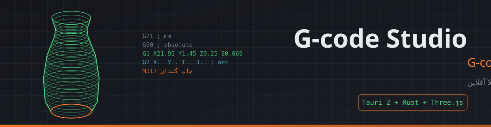
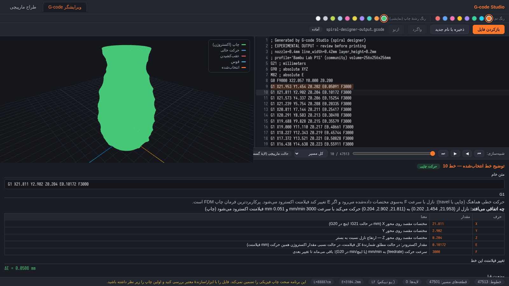
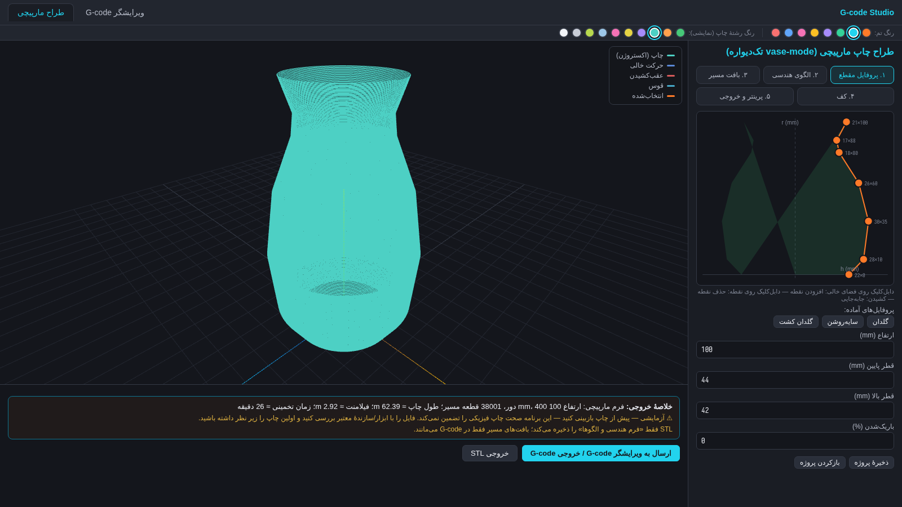
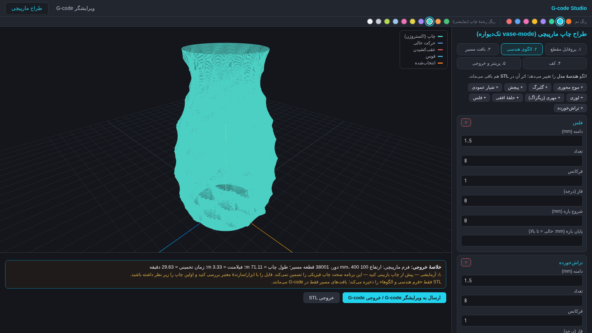
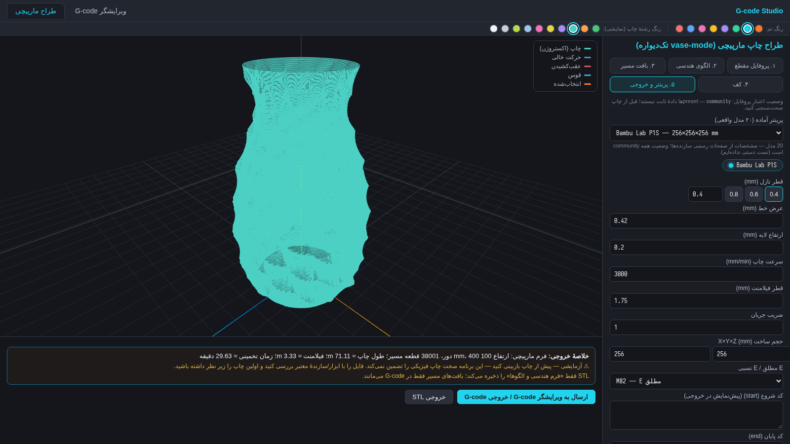
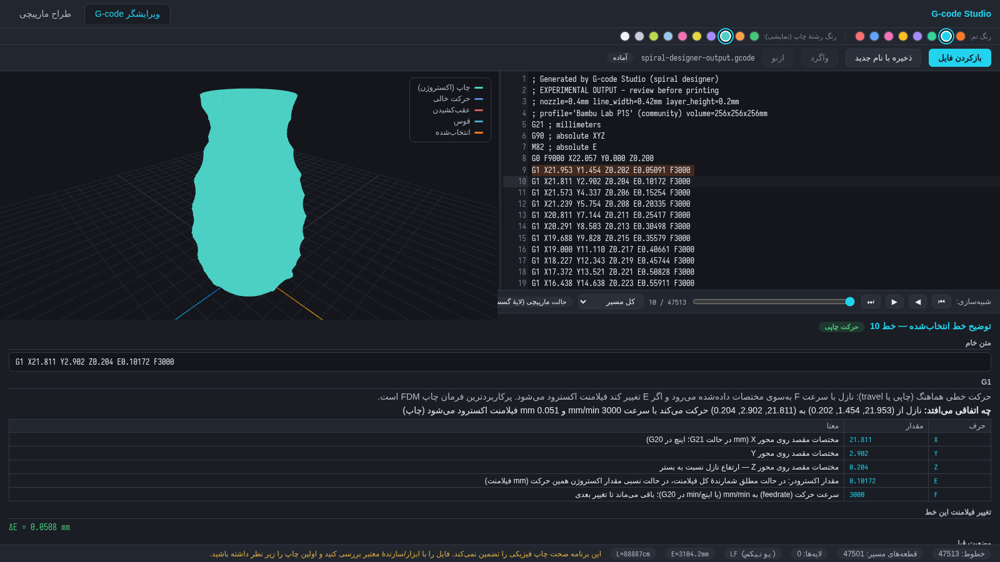

<div dir="rtl">

[//]: # (زبان سند: فارسی — RTL)



# 🧰 G-code Studio — استودیوی ویرایش و طراحی G-code

> **نرم‌افزار دسکتاپ ویندوز، کاملاً آفلاین، فارسی/RTL** — طبق مشخصات کامل پوشهٔ `Docs/` ساخته شده است.

[](https://github.com/pranses2011/Sahand_OGCode_Studio/releases)
[](https://github.com/pranses2011/Sahand_OGCode_Studio/actions/workflows/windows-build.yml)
[](https://github.com/pranses2011/Sahand_OGCode_Studio/releases)
[](src-tauri/core)
[](src/lib/tauri.test.ts)
[](Docs/SAFETY.md)
[](LICENSE)

---

## ⚡ معرفی

**G-code Studio** دو ماژول مستقل اما مرتبط دارد:

1. **ویرایشگر و تحلیل‌گر G-code** — بازکردن فایل محلی، متن کد و بازسازی سه‌بعدی مسیر نازل کنار هم، توضیح فارسی دقیق هر خط با پارامترها و وضعیت ماشین قبل/بعد، ویرایش زنده با به‌روزرسانی پیش‌نمایش، و «ذخیره با نام جدید» بدون بازنویسی فایل اصلی.
2. **طراح چاپ مارپیچی (vase-mode)** — ساخت فرم چرخشی از منحنی مقطع با گردش‌کار ۵ گامی (پروفایل → الگوی هندسی → بافت مسیر → کف → تنظیمات پرینتر)، پیش‌نمایش زنده و خروجی STL/G-code.

هیچ سرور، حساب کاربری، آپلود، CDN، telemetry یا auto-update وجود ندارد؛ همهٔ پردازش‌ها محلی روی سیستم شما انجام می‌شود.

## 📸 محیط واقعی برنامه

> این تصاویر **اسکرین‌شات واقعی از خود برنامه** هستند — محاسبات پیش‌نمایش (مارپیچ، الگوها، تفسیر خطوط) توسط همان هستهٔ Rust انجام شده و از طریق پل توسعه به رابط کاربری رسیده است. هیچ عنصری شبیه‌سازی یا رتوش نشده است.

| ویرایشگر G-code با تفسیر فارسی | طراح مارپیچی — گام ۱: پروفایل |
|:---:|:---:|
|  |  |

| گام ۲: ۹ الگوی هندسی | گام ۵: ۲۰ پریست پرینتر واقعی |
|:---:|:---:|
|  |  |

<p align="center">
  
  <br/><em>۸ تم رنگی + ۱۰ رنگ رشتهٔ چاپ (نمایشی) — این تصویر: تم «سایان» و رشتهٔ فیروزه‌ای</em>
</p>

## 🎨 رنگ‌ها و الگوها (جدید در ۱.۱.۰)

**۹ الگوی هندسی** (هندسهٔ مدل را تغییر می‌دهند → در STL می‌مانند):

| الگو | توضیح |
|---|---|
| موج محوری | برجستگی سینوسی دور محور، با فرکانس عمودی |
| گلبرگ (چندلوبی) | k گلبرگ با فرم cos² |
| پیچش | موجی که با ارتفاع می‌چرخد (توهم تاب) |
| شیار عمودی | کانال‌های عمودی مثل ستون کلاسیک |
| **لوزی** 🆕 | شبکهٔ لوزی از برجستگی‌ها (زاویه × ارتفاع) |
| **مهری (زیگزاگ)** 🆕 | موج مثلثی مورب — چین‌مانند |
| **حلقهٔ افقی** 🆕 | برجستگی‌های حلقه‌ای مستقل از زاویه (دیوارهٔ داسی) |
| **فلس** 🆕 | ردیف‌های مورب فلس‌های هم‌پوشان (زره‌مانند) |
| **تراش‌خورده** 🆕 | مقطع k-ضلعی منتظم با عمق کنترل‌شونده و چرخش اختیاری با ارتفاع |

**۶ بافت مسیر** (مسیر نازل را تعدیل می‌کنند → فقط در G-code):

موجک (ریپل) • تور بافته • بخیه‌ای • **شیار مارپیچی** 🆕 • **چکشی** 🆕 (قطعی و بدون RNG) • **سبدی** 🆕

**۸ تم رنگی** (نارنجی صنعتی، سایان، سبز، بنفش، کهربایی، سرخابی، آبی، قرمز) + **۱۰ رنگ رشتهٔ چاپ** برای پیش‌نمایش سه‌بعدی — با ماندگاری محلی (بدون ذخیرهٔ راه‌دور).

## 🖨️ ۲۰ پریست پرینتر واقعی (گام ۵)

مشخصات حجم ساخت از صفحات رسمی سازنده‌ها؛ وضعیت همه **community** است (دادهٔ عمومی، اما روی دستگاه توسط ما آزموده نشده — قاعدهٔ صداقت):

| پرینتر | حجم ساخت (mm) | | پرینتر | حجم ساخت (mm) |
|---|---|---|---|---|
| Bambu Lab A1 mini | 180×180×180 | | Creality Ender 5 S1 | 220×220×280 |
| Bambu Lab A1 | 256×256×256 | | Creality K1 | 220×220×250 |
| Bambu Lab P1S | 256×256×256 | | Creality K1 Max | 300×300×300 |
| Bambu Lab X1 Carbon | 256×256×256 | | Anycubic Kobra 2 | 220×220×250 |
| Prusa MK3S+ | 250×210×210 | | Anycubic Kobra 3 | 250×250×260 |
| Prusa MK4 | 250×210×220 | | Artillery Sidewinder X2 | 300×300×400 |
| Prusa MINI+ | 180×180×180 | | Sovol SV06 | 220×220×250 |
| Prusa XL | 360×360×360 | | Elegoo Neptune 4 | 225×225×265 |
| Creality Ender 3 S1 | 220×220×270 | | QIDI X-Plus 3 | 280×280×270 |
| Creality Ender 3 V3 KE | 220×220×240 | | Voron 2.4 (350) | 350×350×250 |

> سرعت‌های درج‌شده «سرعت شروع محافظه‌کارانه برای چاپ مارپیچی» هستند، نه حداکثر سرعت رسمی دستگاه — این انتخاب عمدی و مستند است.

## 🧱 پشتهٔ فنی

| لایه | فناوری |
|---|---|
| پوستهٔ دسکتاپ | **Tauri 2** (WebView2 با `offlineInstaller`) |
| هستهٔ محاسباتی | **Rust** — parser/مفسر/طراح/خروجی‌ساز خالص |
| رابط کاربری | **React 18 + TypeScript + Vite** |
| ویرایشگر کد | **CodeMirror 6** |
| نمایش سه‌بعدی | **Three.js (WebGL2)** |
| آزمون | **cargo test** (۱۲۷ آزمون) + **Vitest** (۱۴ آزمون) |

## 📦 نصب

### دانلود نصب‌کنندهٔ رلیس (ساده‌ترین راه)

1. به بخش **[Releases](https://github.com/pranses2011/Sahand_OGCode_Studio/releases)** ریپازیتوری بروید.
2. در آخرین رلیس (مثلاً `v1.1.0`) فایل **`G-code Studio_1.1.0_x64-setup.exe`** را دانلود کنید — این فایل توسط CI ویندوزِ گیت‌هاب از همین سورس ساخته شده است.
3. فایل را اجرا کنید؛ نصب per-user است و به admin نیاز ندارد.

اگر رلیسی موجود نیست (مثلاً پیش از اولین تگ): تب **Actions** → workflow **windows-build** → آخرین اجرای موفق → artefact **`gcode-studio-windows-x64`**.

### مشخصات نصب

- **هدف:** Windows 10 22H2 / Windows 11 x64
- **نصب per-user** (بدون نیاز به admin)
- **WebView2 با حالت `offlineInstaller`** داخل نصب‌کننده بسته‌بندی شده است → **نصب روی سیستم بدون اینترنت و بدون runtime از پیش نصب‌شده ممکن است** (بدون bootstrapper آنلاین).
- گزینهٔ `fixedRuntime` عمداً به‌کار نرفته: حجم نصب‌کننده را چند ده مگابایت بزرگ می‌کند و به‌روزرسانی امنیتی WebView2 را از کنترل کاربر خارج می‌کند. اگر این trade-off برایتان مهم است، در `src-tauri/tauri.conf.json` قابل تغییر است.
- حذف برنامه (uninstall) فایل‌های G-code و پروژه‌های شما را پاک **نمی‌کند**.

### build از سورس

```bash
# پیش‌نیاز: Node 20+ و Rust stable
npm install
npm test              # آزمون‌های فرانت‌اند (Vitest)
cd src-tauri
cargo test -p gcode-core   # ۱۲۷ آزمون هستهٔ Rust
cd ..
npm run tauri build   # روی ویندوز: NSIS .exe در src-tauri/target/release/bundle/nsis/
```

> **محدودیت صادقانهٔ محیط:** این ریپو روی سرور Linux توسعه یافته است؛ build پوستهٔ Tauri (که به WebView2/GTK وابسته است) روی Windows انجام می‌شود — CI گیت‌هاب همین کار را می‌کند و روی تگ‌های `v*` رلیس با فایل نصب می‌سازد. **تست نصب آفلاین روی ویندوز واقعی با اینترنت قطع، در محیط توسعه انجام نشده و «اجرا‌نشده» گزارش می‌شود.**

## 🛠️ توسعه در مرورگر (پل هستهٔ Rust)

برای توسعهٔ رابط کاربری بدون پوستهٔ دسکتاپ، `npm run dev` سرو می‌کند و دستورهای محاسباتی (تفسیر/طراح/پریست‌ها) از طریق پل توسعه به **باینری `gcode-cli`** (همان هستهٔ Rust، بدون هیچ دادهٔ ساختگی) وصل می‌شوند:

```bash
cargo build -p gcode-cli   # یک‌بار در src-tauri
npm run dev                # http://localhost:1420
```

دیالوگ‌های فایل native و Save As فقط در پوستهٔ دسکتاپ کار می‌کنند (خطای صادقانه می‌گیرید، نه رفتار جعلی).

## 🗂️ ساختار پروژه

```text
Docs/                    # اسناد الزام + مستندات + اسکرین‌شات‌ها و گرافیک
src-tauri/
  core/src/              # هستهٔ Rust خالص (بدون وابستگی به Tauri)
    gcode/               #   lexer، doc (BOM/پایان‌خط)، interpreter (modal-state)
    toolpath/            #   IR مشترک + قوس‌های G2/G3
    designer/            #   پروفایل، الگو، بافت، اسپیرال، کف، پریست‌های پرینتر
    export/              #   G-code، STL باینری، پروژهٔ JSON، اعتبارسنجی Save
    ipc.rs               #   منطق ۱۱ دستور IPC (قابل‌آزمون)
  cli/                   # gcode-cli — پل توسعهٔ مرورگر به همان هسته
  src/                   # پوستهٔ Tauri (wrapperهای نازک + دیالوگ native)
  capabilities/          # حداقل دسترسی (فقط core+dialog)
src/                     # رابط React فارسی RTL
  app/ components/ features/ i18n/ lib/ styles/ test-fixtures/
.github/workflows/       # CI build ویندوز + رلیس خودکار روی تگ v*
```

## ✅ آزمون‌های واقعاً اجراشده

| مجموعه | تعداد | وضعیت | محیط |
|---|---|---|---|
| `cargo test -p gcode-core` | ۱۲۷ | ✅ همه پاس | Linux (هسته خالص پلتفرم‌مستقل) |
| `npm test` (Vitest) | ۱۴ | ✅ همه پاس | Node 24 |
| `tsc --noEmit` + `vite build` | — | ✅ بدون خطا | Linux |
| build ویندوز NSIS | — | ✅ از طریق CI | GitHub Actions Windows runner |
| **نصب/اجرا روی ویندوز با اینترنت قطع** | — | ❌ **اجرا‌نشده** | نیاز به سیستم ویندوز واقعی |

پوشش آزمون‌های هسته: lexer (فشرده/N/checksum/کامنت/M117/NaN)، مفسر modal (هر ۵ fixture سند + قوس R و IJ + bounds + spiral + macro)، قوس‌ها (سه صفحه/مارپیچ/خطاها)، doc (BOM/CRLF/roundtrip)، طراح (mesh/STL/۹ الگو/۶ بافت/کف/۲۰ پریست پرینتر/اعتبارسنجی)، خروجی (E مطلق-نسبی/STL binary/سیاست checksum)، IPC (payload/Save As).

## 🔒 امنیت و حریم خصوصی

- فقط ۱۱ دستور IPC دامنه‌ای؛ **هیچ shell/eval/شبکه‌ای وجود ندارد**.
- دسترسی فایل فقط از دیالوگ native (capability فقط `core:default` + `dialog:default`).
- CSP بدون هیچ remote source؛ همهٔ assetها داخل باندل.
- بدون telemetry/log محتوا؛ تنظیمات فقط در AppData.

## ⚠️ ایمنی چاپ

> **این برنامه صحت چاپ فیزیکی را تضمین نمی‌کند.** فایل را با ابزار/سازندهٔ معتبر بررسی کنید و اولین چاپ را زیر نظر داشته باشید. جزئیات در [`Docs/SAFETY.md`](Docs/SAFETY.md).

## 📚 مستندات

| سند | محتوا |
|---|---|
| [`Docs/REFERENCE_AUDIT.md`](Docs/REFERENCE_AUDIT.md) | پژوهش مرجع OGcode (۲۰۲۶-۱۰-۱۶) با منابع و محدودیت‌های دسترسی |
| [`Docs/ARCHITECTURE.md`](Docs/ARCHITECTURE.md) | معماری و تصمیم‌های ADR-001..008 |
| [`Docs/USER_GUIDE_FA.md`](Docs/USER_GUIDE_FA.md) | راهنمای کاربر فارسی |
| [`Docs/SAFETY.md`](Docs/SAFETY.md) | ایمنی چاپ و مرزهای نرم‌افزار |
| [`Docs/FINAL_REPORT_FA.md`](Docs/FINAL_REPORT_FA.md) | گزارش تحویل فارسی با موارد اجراشده/نشده |

## 📜 مجوز

مطابق فایل [LICENSE](LICENSE) ریپازیتوری.

</div>
